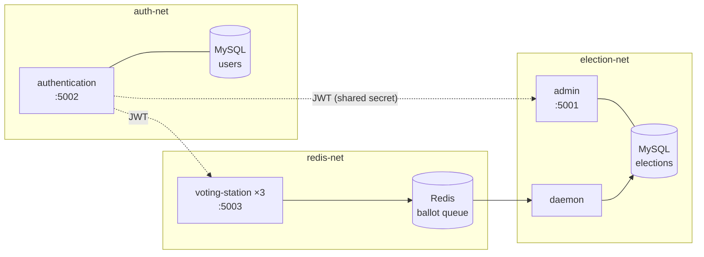

# Election management system

[](https://github.com/FansteLK/System-for-election--managment-process/actions/workflows/ci.yml)

A containerized microservice system for running elections, from voter-official accounts to D'Hondt seat allocation. It is built with **Python, Flask, SQLAlchemy, Redis, MySQL, JWT and Docker Swarm**.

Administrators register parties or candidates and schedule elections. Election officials upload ballots as CSV files at voting stations. A background daemon validates every ballot against the running election. After the election closes, administrators get the results: the vote share for presidential elections, or seats by the **D'Hondt method** with a 5% threshold for parliamentary ones.

## Architecture



| Component | Responsibility |
| --- | --- |
| **authentication** | Registration with JMBG, email and password validation; login; refresh tokens; user deletion. Issues JWTs that carry the user's role and JMBG. |
| **admin** | Creates participants and elections, rejecting overlaps and mixed party/candidate lists, and computes results. |
| **voting-station** | Accepts a CSV of `ballot-guid,poll-number` rows from officials, validates the whole file, then queues it in Redis. It runs 3 replicas in Swarm. |
| **daemon** | Pops ballots atomically with `BLPOP` and records each one against the active election. Duplicates and unknown poll numbers are stored as invalid with a reason. Ballots that arrive while no election is running are discarded. |

The services share no database. They trust each other only through JWTs signed with a shared secret. Docker networks enforce the isolation required by the spec: the voting station can reach only Redis, the admin service only the election database, and nothing else can reach the authentication database.

## Quick start

Requirements: Docker with Compose v2.

```bash
cp .env.example .env              # change the secrets for anything non-local
docker compose up -d --build
python3 scripts/demo.py           # runs a complete election end to end
```

<details>
<summary>Demo output</summary>

```
✔ all services healthy
✔ logged in as administrator
✔ registered election official official-a84955@example.com
✔ created a parliamentary election closing at 23:15:29 UTC, poll numbers [1, 2, 3, 4]
✔ uploaded 1002 ballots through the voting station
… waiting for the election to close

Seat allocation (250 seats, D'Hondt, 5% census):
  1. Green Future        109
  2. Workers' Union       81
  3. Liberal Alliance     60
  4. Fringe List           0
Rejected ballots:
  390f190f…  poll 1   Duplicate ballot.
  e45f0552…  poll 99  Invalid poll number.
```
</details>

### Deploying to Docker Swarm

```bash
docker build -t election-system:latest .
docker swarm init
export JWT_SECRET_KEY=... MYSQL_ROOT_PASSWORD=...
docker stack deploy -c deploy/stack.yml election
```

## API

All endpoints except `/register`, `/login` and `/health` require `Authorization: Bearer <token>`. Errors return `400 {"message": "..."}`. A missing or insufficient token returns `401 {"msg": "Missing Authorization Header"}`.

| Service | Method & path | Role | Body / query |
| --- | --- | --- | --- |
| authentication | `POST /register` | – | `jmbg, forename, surname, email, password` |
| | `POST /login` | – | `email, password` → `accessToken, refreshToken` |
| | `POST /refresh` | refresh token | → `accessToken` |
| | `POST /delete` | admin | `email` |
| admin | `POST /createParticipant` | admin | `name, individual` → `id` |
| | `GET /getParticipants` | admin | |
| | `POST /createElection` | admin | `start, end` (ISO 8601), `individual, participants[]` → `pollNumbers` |
| | `GET /getElections` | admin | |
| | `GET /getResults?id=N` | admin | → `participants[{pollNumber, name, result}], invalidVotes[]` |
| voting-station | `POST /vote` | official | multipart `file`: CSV `guid,pollNumber` |

Example:

```bash
TOKEN=$(curl -s localhost:5002/login -H 'Content-Type: application/json' \
  -d '{"email":"admin@admin.com","password":"1"}' | python3 -c 'import sys,json;print(json.load(sys.stdin)["accessToken"])')
curl -s localhost:5001/getElections -H "Authorization: Bearer $TOKEN"
```

## Development

```bash
python3.12 -m venv .venv && source .venv/bin/activate
pip install -r requirements-dev.txt
pytest            # 56 tests, SQLite and fakeredis, no Docker needed
ruff check .
```

The tests cover validation rules (JMBG checksums and calendar dates, passwords), authorization, election overlap detection, D'Hondt allocation, CSV parsing, and full cross-service flows from upload to daemon to results.

CI runs lint and unit tests. It then builds the images, boots the whole stack with Docker Compose, and runs `scripts/demo.py` against it.

```
election/
  authentication/   user accounts and JWT issuing
  admin/            participants, elections, results (results.py: D'Hondt)
  voting_station/   CSV ballot intake → Redis
  daemon/           Redis → validated votes in MySQL
  models.py         election schema shared by admin and daemon
  init_db.py        creates tables and seeds the admin account (idempotent, retries until DB is up)
deploy/stack.yml    Docker Swarm stack
docker-compose.yml  local stack
```

## Background

This was built for the *Infrastructure for Electronic Business* course at the School of Electrical Engineering, University of Belgrade (2021). The original specification, in Serbian, is in [`docs/`](docs/specification-sr.pdf).

The project was later rewritten (v2) from the original course submission:

- **Security:** passwords are hashed instead of stored in plaintext, secrets come from the environment, an unauthenticated endpoint that listed all users was removed, and containers run as non-root.
- **Correctness:**
  - The daemon no longer loses ballots between `LRANGE` and `LTRIM`, and it no longer busy-waits.
  - A rejected CSV no longer leaves earlier rows queued.
  - Invalid ballots are excluded from results.
  - "Election is ongoing" is enforced.
  - Elections that fully contain an existing one are detected.
  - JMBG validation handles August and September correctly.
  - D'Hondt no longer crashes when no list passes the threshold.
- **Structure:**
  - One Python package and one image instead of copy-pasted modules and a committed virtualenv.
  - Flask 3, SQLAlchemy 2, and gunicorn instead of the Flask dev server.
  - Idempotent DB init instead of generating migrations at container start.
  - A test suite and CI.
